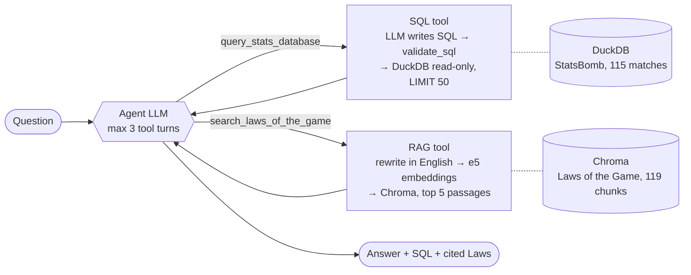

# Football AI Agent

[](https://github.com/badreddinemarz/football-ai-agent/actions/workflows/ci.yml)


An LLM agent that answers questions about the **2022 World Cup and Euro 2024** (statistics, through SQL) and the
**IFAB Laws of the Game** (through RAG), and that was **evaluated on 48 questions against 4 baselines**.

A real answer from the evaluation (Claude Haiku 5.5, test question `mixed02`):

```text
Q:   How many own goals were scored at Euro 2024, and what is awarded if a throw-in goes directly
     into the thrower's own goal?

A:   Own goals at Euro 2024: The database records 10 own goals.
     Throw-in into the thrower's own goal: A goal cannot be scored directly from a throw-in. If the ball
     goes directly into the thrower's own goal, a corner kick is awarded to the opponents (Law 15).

tools: query_stats_database, search_laws_of_the_game
SQL:   SELECT (SELECT COALESCE(SUM(goals_for), 0) FROM team_matches WHERE competition = 'UEFA Euro')
            - (SELECT COUNT(*) FROM goal_events WHERE competition = 'UEFA Euro') AS own_goals
```

## Results

The same 48 questions, with 4 configurations: the LLM alone (A), RAG only (B), SQL only (C), and the agent with
both tools (D). The full table is in [eval/results.md](eval/results.md).

| Model | A · LLM alone | B · RAG only | C · SQL only | **D · Agent** | Median latency (agent) |
|---|---|---|---|---|---|
| Claude Haiku 5.5 (API) | 60 % | 35 % | 54 % | **96 %** (46/48) | 4.8 s |
| Qwen 2.5 7B (local, CPU) | 21 % | 27 % | 27 % | **62 %** (30/48) | 52 s |

Agent with Claude Haiku, by category:

| Statistics | Rules | Mixed (both tools) | Off-topic (must refuse) | Right tools | Recall@5 | Faithfulness |
|---|---|---|---|---|---|---|
| 20/20 | 15/15 | 6/8 | 5/5 | 96 % | 91 % | 91 % |

**Main takeaways**

- **The tools matter more than the model.** Qwen 7B with tools (62 %) beats Claude Haiku without them (60 %).
- **Both models pick the right tools 96 % of the time.** The errors come from *running* the tools, mostly
  SQL that runs fine but returns a wrong number.
- **Agentic search** (the agent checks the passages and searches again with the official vocabulary)
  raised the score from 44/48 to 46/48, for +14 % tokens.
- **The whole evaluation cost $0.94** in Claude API calls (answers and judges).

What went wrong and what it taught me: [eval/error_analysis.md](eval/error_analysis.md).

## How it works



**The agent** ([src/agent.py](src/agent.py)) is a hand-written tool-calling loop. The LLM chooses a tool, the
code runs it and sends the result back, and this repeats for at most 3 turns before the final answer. A
mixed question uses both tools. The system prompt has 3 rules: split the question, use both tools when
needed, and never answer from memory.

**The SQL tool** ([src/sql_tool.py](src/sql_tool.py)):

- The LLM writes the query from schema notes, few-shot examples, and two **SQL views** (`goal_events`,
  `team_matches`). These views act as a semantic layer that hides the traps of the raw data: penalty
  shoot-outs that are not goals, two-yellow red cards, own goals.
- Every query goes through `validate_sql`: one `SELECT` only, no writes, it must read a table. It then runs
  on a **read-only** connection with a `LIMIT`.
- Database errors are sent back to the LLM, which gets one more attempt (self-correction).

**The RAG tool** ([src/rag_tool.py](src/rag_tool.py)):

- The PDF is split **by law and then by section**, into chunks of at most 300 words. That limit keeps every
  chunk under the 512-token window of `intfloat/multilingual-e5-base`.
- The question is first rewritten as an English search query (few-shot). On French questions, this raised
  retrieval from 60 % to 97 %.
- The answer must come only from the passages, cite the law, and say "I don't know" otherwise.

**A second agent built with LangGraph** ([src/agent_langgraph.py](src/agent_langgraph.py)) uses the same tools
and prompt. It scored 44/48, the same as the hand-written loop within noise. It adds **conversation memory**:

- A checkpointer gives each conversation its own `thread_id`.
- Before each call, the history is compacted: old turns become just the question and the answer. On an
  8-question conversation, this cut the tokens read by the LLM by 30 % with 8/8 correct answers.

## Evaluation

- **48 test questions** ([eval/questions.jsonl](eval/questions.jsonl)): 20 statistics, 15 rules (covering 14
  laws), 8 mixed, 5 off-topic. They were never used to tune prompts: tuning used separate development sets.
- **The ground truth is computed, never typed by hand.**
  - [eval/build_gold.py](eval/build_gold.py) produces the expected numbers in SQL. An independent script
    recomputed all 40 numeric answers from the raw StatsBomb JSON, and they matched 40/40.
  - Every rules reference was found word for word in the official PDF.
- **Metrics** ([eval/metrics.py](eval/metrics.py)):
  - numeric exact match;
  - an LLM judge for free-text answers (Claude Sonnet 5.5, so a model never grades its own answers);
  - right tools, recall@5 by law, faithfulness to the retrieved context, latency and tokens.
- **The judge was validated by hand.** I graded 30 answers blind and the judge agreed on 24 of them (80 %,
  Cohen's κ ≈ 0.6). In 5 of the 6 disagreements the judge was stricter than me, so judged scores are, if
  anything, underestimated.
- **Built to run overnight on a laptop.** Every answer is cached on disk, an interrupted run resumes where it
  stopped, errors are never cached, and a `--budget` option stops the run before the dollar limit.

```bash
.venv/Scripts/python eval/evaluate.py --model claude-haiku-5-5 --budget 1.50
.venv/Scripts/python eval/evaluate.py --report        # rewrite eval/results.md from the cache
```

## Interfaces

| | How | What for |
|---|---|---|
| **REST API** | [app/api.py](app/api.py), FastAPI | `POST /ask` returns the answer, tools, SQL, sources, latency and a `conversation_id` for follow-up questions. `GET /health`. 503 if the LLM is unreachable |
| **MCP server** | [app/mcp_server.py](app/mcp_server.py) | Exposes `get_database_schema`, `query_database` and `search_laws` to any MCP client, such as Claude Code. [src/agent_mcp.py](src/agent_mcp.py) is a LangGraph agent that uses it through `langchain-mcp-adapters` |
| **Tracing** | LangSmith | Every LLM call, SQL query and search becomes a span with its latency and tokens. Set `LANGSMITH_TRACING=true` in `.env` |
| **Docker** | [Dockerfile](Dockerfile) | CPU-only image with the embedding model included. The key and the data are given at run time |
| **CI** | [.github/workflows/ci.yml](.github/workflows/ci.yml) | Runs on every push, without a key or data: the pytest suite (fake LLMs), then building the image and checking that `/health` answers 200 and `/ask` answers 503 |

## Run it

**1. Install** (Python 3.13; Windows paths shown)

```bash
python -m venv .venv
.venv/Scripts/pip install torch --index-url https://download.pytorch.org/whl/cpu
.venv/Scripts/pip install -r requirements.txt
```

**2. Build the data** (`data/` is not in git)

```bash
.venv/Scripts/python scripts/download_data.py    # StatsBomb open data → data/raw/
.venv/Scripts/python scripts/build_db.py         # → data/football.duckdb
# Download the Laws of the Game (English, 2026/27) from theifab.com → data/laws_of_the_game.pdf
.venv/Scripts/python scripts/build_index.py      # → data/chroma/
```

**3. Choose the LLM**

- **Local, free:** install [Ollama](https://ollama.com) and run `ollama pull qwen2.5:7b`. This is the default.
- **Claude API:** create a `.env` file with `ANTHROPIC_API_KEY=...` and `LLM_MODEL=claude-haiku-5-5`.

**4. Ask**

```bash
.venv/Scripts/python -m uvicorn app.api:app      # then open http://127.0.0.1:8000/docs
```

Set `AGENT=langgraph` to use the LangGraph agent, which has conversation memory.

**With Docker**

```bash
docker build -t football-agent .
docker run --rm -p 8000:8000 --env-file .env -v "$(pwd)/data:/app/data" football-agent
```

**Tests** (64 tests, no LLM and no API key needed)

```bash
.venv/Scripts/python -m pytest -q
```

## Project structure

```text
scripts/   download_data.py, build_db.py (tables + SQL views), build_index.py (PDF → Chroma)
src/       llm.py (Ollama / Claude behind one function), sql_tool.py, rag_tool.py,
           agent.py (hand-written loop), agent_langgraph.py (LangGraph + memory), agent_mcp.py (MCP client)
app/       api.py (FastAPI), mcp_server.py (MCP server)
eval/      questions.jsonl, build_gold.py, metrics.py, evaluate.py, validate_judge.py,
           results.md, error_analysis.md, experiments/
tests/     pytest suite: fake LLMs, in-memory MCP server, FastAPI TestClient
```

## Limitations

- **48 questions is a small sample.** One question is worth about 2 points, so only large gaps (21 → 62 %,
  62 → 96 %) are conclusive.
- **Some runs predate later fixes.**
  - The Qwen runs and the first Haiku runs used an older index (103 chunks of up to 400 words, some
    truncated by the embedding model) and an accent-sensitive name filter.
  - The Haiku agent runs with agentic search (96 %) were made after both fixes.
- **The faithfulness judge (Claude Haiku) was not validated by hand**, and it also grades Haiku's own answers.
- **The agent works in English.** In French, the 7B model distorted the rules when rephrasing them.
  French questions are still translated for the search.
- **Two errors remain** with Haiku, both silent SQL errors. The first is "missed penalties", where it
  counted 1 instead of 6 because it left out saved penalties. The second is a knockout-stage goal count of
  51 instead of 52, because an own goal is missing from the goals view.
- **Coverage is limited:** two tournaments (115 matches) and one edition of the Laws of the Game.
- **The API's conversation memory is held in RAM**, so it is lost when the server restarts.

## Data and license

- Match data: [StatsBomb Open Data](https://github.com/statsbomb/open-data), used under its license, with
  thanks to StatsBomb.
- Rules: the *Laws of the Game* © IFAB, [theifab.com](https://www.theifab.com). The PDF is not redistributed
  here.
- Code: [MIT](LICENSE).
